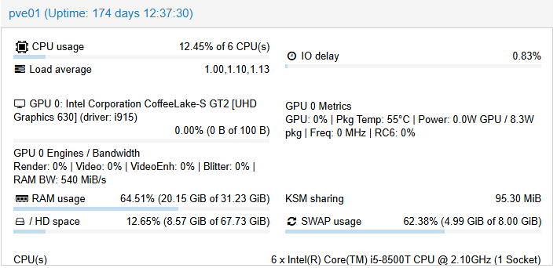
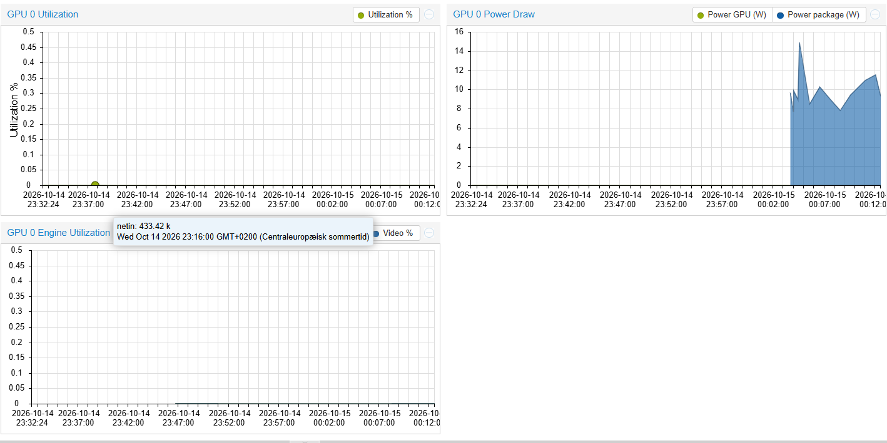

# PVE GPU Dashboard Mod — Intel Edition

Native Intel GPU monitoring integration for the Proxmox VE web interface (PVE 8.x/9.x).

This is an Intel adaptation of [en4ble1337/proxmox-gpu-dashboard](https://github.com/en4ble1337/proxmox-gpu-dashboard)
(NVIDIA). The UI integration, StatusView widgets, RRD model fields and history-chart
approach are taken from that project — all credit goes to the original author (see
[Credits](#credits)). Only the data-collection layer has been rewritten for Intel GPUs.

Unlike the NVIDIA original (which shells out to `nvidia-smi` on every API poll), this
version runs a lightweight systemd **sampler** that keeps a persistent, line-buffered
`intel_gpu_top -J` stream and writes the latest sample to
`/var/lib/pve-gpu-intel/status.json`. The patched PVE API block just reads that file,
so dashboard polling stays fast even though `intel_gpu_top` itself takes ~1s per sample.

## What you get

### Status section (real-time)



- GPU utilization progress bar
- Metrics line: `GPU % | Package temp | Power (GPU W / package W) | Frequency | RC6 %`
- Engine breakdown line: `Render | Video | VideoEnhance | Blitter | RAM bandwidth`

### Historical graphs (below Network traffic)



- Temperature (CPU package), Utilization, Power (GPU + package series), Engine utilization (Render/Video)
- 24 hours at 1-minute intervals, stored in browser localStorage (same approach as upstream v3.0)

## How it works

Two core PVE files are patched (timestamped backups are created first):

- `/usr/share/perl5/PVE/API2/Nodes.pm` — reads the sampler JSON and exposes `gpu0_*` fields in the node status API
- `/usr/share/pve-manager/js/pvemanagerlib.js` — StatusView items, RRD model fields, history store + charts

Plus one new service:

- `pve-gpu-intel-sampler.service` — Python3 sampler (`/usr/local/bin/pve-gpu-intel-sampler`)

## Prerequisites

- Proxmox VE 8.x or 9.x
- Intel GPU (iGPU or Arc) visible on the **host** (not fully passed through to a VM)
- `intel-gpu-tools` (installed automatically by the script if missing)

## Tested configurations

| PVE version | GPU | Notes |
|-------------|-----|-------|
| 8.4.21 | Intel UHD Graphics 630 (Coffee Lake-S) | Full support incl. per-GPU power via RAPL |
| 8.4.19 | Intel HD Graphics (Haswell-ULT) | GPU power domain dead in firmware — package power shown instead |

## Installation

```bash
bash pve-gpu-intel-mod.sh install
```

Then hard-refresh your browser (Ctrl+Shift+R / Cmd+Shift+R).

## Uninstall

```bash
bash pve-gpu-intel-mod.sh uninstall
```

Restores the timestamped backups from `~/PVE-GPU-DASHBOARD/` and removes the sampler service.

## Intel-specific limitations (hardware, not software)

- **Temperature**: Intel iGPUs have no dedicated temperature sensor; the CPU **package** temperature (coretemp) is shown and labeled as such.
- **GPU power**: read from the RAPL powercap domain. Works on many server/desktop CPUs (e.g. Coffee Lake-S), but some mobile CPUs (e.g. Haswell-ULT) never report the GPU/uncore domain — package power is always shown alongside so you can tell the difference.
- **Fan**: iGPUs have no own fan sensor (shown as N/A).
- **VRAM**: iGPUs share system RAM; per-GPU memory usage is not reported (shown as 0).
- **RC6**: idle-sleep %; some older generations report 0 constantly.

## Credits

- **[en4ble1337](https://github.com/en4ble1337)** for the original [proxmox-gpu-dashboard](https://github.com/en4ble1337/proxmox-gpu-dashboard) — the UI integration, widget layout, RRD field approach and history-chart design of this project come from there. Go star the original repo.
- The upstream project itself credits **Meliox** (`pve-mod-gui-nvidia.sh`), which in turn follows the long line of community PVE GUI mods.
- `intel-gpu-tools` / `intel_gpu_top` by Intel and the linux-intel-gpu-tools contributors.

## License

MIT (see [LICENSE](LICENSE)). The original upstream project is published under its own
terms; this fork's modifications and integration code are released under MIT with full
credit to the original author above.
